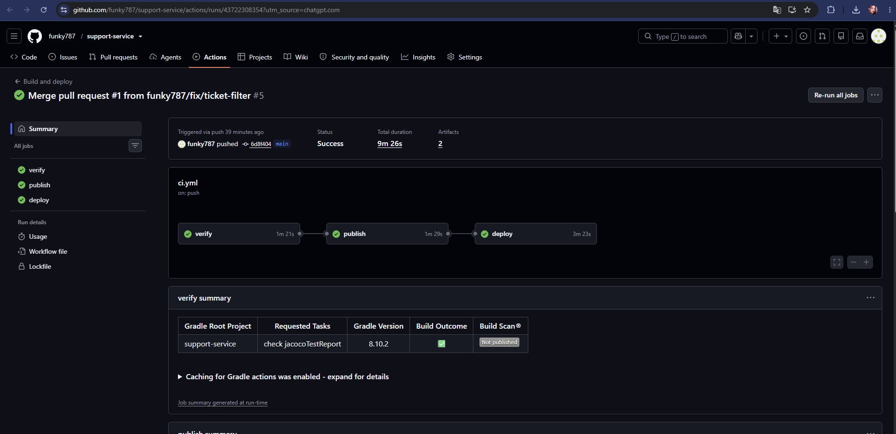
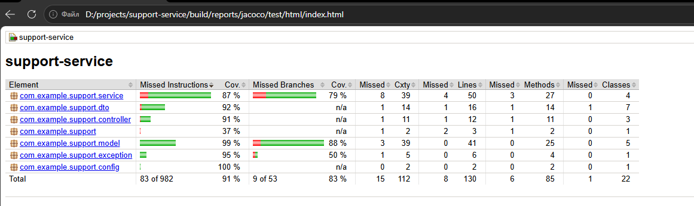
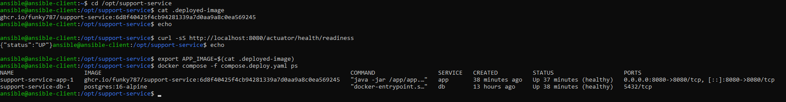

# Support Service

REST API для работы с заявками в техподдержку.

Проект на Java и Spring Boot, для базы использовал PostgreSQL. Ещё добавил Kotlin для подсчёта статистики.

В приложении можно создавать заявки, редактировать их, менять статусы и смотреть историю изменений. Есть фильтрация по категории, приоритету, статусу и просрочке.

Статусы идут в таком порядке: NEW → IN_PROGRESS → RESOLVED. Заявку также можно отменить. Закрытые заявки редактировать нельзя.

## Запуск

Проще всего запустить через Docker.


```
Copy-Item .env.example .env
docker compose up --build -d
```

После запуска Swagger будет здесь:

http://localhost:8080/swagger-ui/index.html

Там можно проверить все запросы.

## Тесты

Для тестов использовал JUnit, Mockito и Testcontainers. Интеграционные тесты запускаются с PostgreSQL через Docker.

Запуск:

```
.\gradlew.bat clean check jacocoTestReport
```

Отчёт по тестам лежит в `build/reports/tests/test/index.html`, покрытие — в `build/reports/jacoco/test/html/index.html`.

Во время проверки нашёл ошибку с фильтром `overdue=false`: заявки без срока выполнения не попадали в результат. Исправил условие и добавил отдельный тест.

## GitHub Actions

Настроил автоматическую проверку тестов, сборку Docker-образа и деплой на Ubuntu.

Для этого использовал GitHub Actions и self-hosted Runner на виртуалке.

Также проверил сохранение данных после перезапуска, резервную копию базы и откат приложения на предыдущий Docker-образ.

## Резервная копия и откат

Для создания резервной копии базы есть скрипт `scripts/backup.sh`. Его можно запустить из корня проекта через Bash:

```bash
bash scripts/backup.sh
```

Резервная копия сохраняется в папку `backups`.

Для проверки восстановления используется:

```bash
bash scripts/restore-test.sh backups/имя_файла.sql
```

Данные восстанавливаются в отдельную тестовую базу, основная при этом не удаляется.

Также проверял откат приложения на предыдущую версию Docker-образа. На Ubuntu для этого скачивал нужную версию из GHCR, переключал образ в Docker Compose и проверял, что приложение снова запускается.

## Если что-то не работает

Если приложение не запускается, сначала смотрю состояние контейнеров:

```bash
docker compose ps
```

Логи приложения:

```bash
docker compose logs app
```

Логи PostgreSQL:

```bash
docker compose logs db
```

Если база недоступна, проверяю контейнер PostgreSQL и настройки подключения в `.env`.

Если приложение не проходит health check, проверяю логи и запрос `/actuator/health/readiness`.

Если возникает ошибка миграции Flyway, смотрю логи приложения и проверяю SQL-файлы в `src/main/resources/db/migration`.

## Скриншоты

Swagger UI:


GitHub Actions:



Покрытие тестами:



Деплой на Ubuntu:


