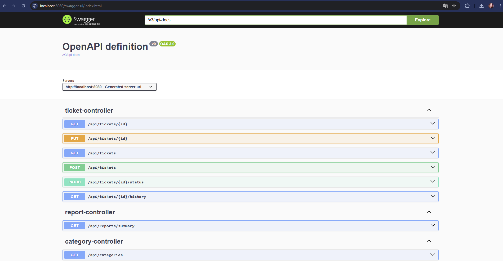

# Support Service

REST API для работы с заявками в техподдержку.

Проект на Java и Spring Boot, для базы использовал PostgreSQL. Ещё добавил Kotlin для подсчёта статистики.

В приложении можно создавать заявки, редактировать их, менять статусы и смотреть историю изменений. Есть фильтрация по категории, приоритету, статусу и просрочке.

Статусы идут в таком порядке: NEW → IN_PROGRESS → RESOLVED. Заявку также можно отменить. Закрытые заявки редактировать нельзя.

## Запуск

Проще всего запустить через Docker.

В PowerShell:

```powershell
Copy-Item .env.example .env
docker compose up --build -d
```

После запуска Swagger будет здесь:

http://localhost:8080/swagger-ui/index.html

Там можно проверить все запросы.

## Тесты

Для тестов использовал JUnit, Mockito и Testcontainers. Интеграционные тесты запускаются с PostgreSQL через Docker.

Запуск:

```powershell
.\gradlew.bat clean check jacocoTestReport
```

Отчёт по тестам лежит в `build/reports/tests/test/index.html`, покрытие — в `build/reports/jacoco/test/html/index.html`.

Во время проверки нашёл ошибку с фильтром `overdue=false`: заявки без срока выполнения не попадали в результат. Исправил условие и добавил отдельный тест.

## GitHub Actions

Настроил автоматическую проверку тестов, сборку Docker-образа и деплой на Ubuntu.

Для этого использовал GitHub Actions и self-hosted Runner на виртуалке.

Также проверил сохранение данных после перезапуска, резервную копию базы и откат приложения на предыдущий Docker-образ.

## Скриншоты

Swagger UI:



GitHub Actions:


Покрытие тестами:


Деплой на Ubuntu:


